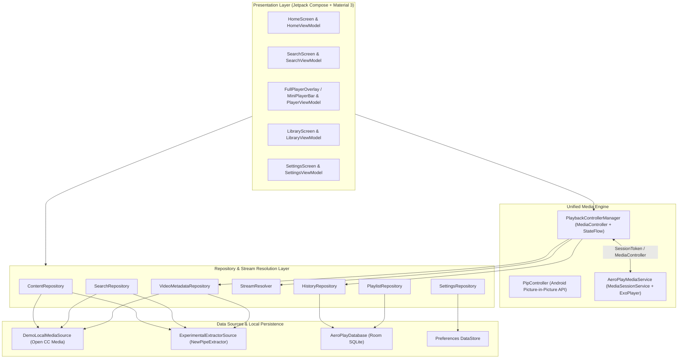
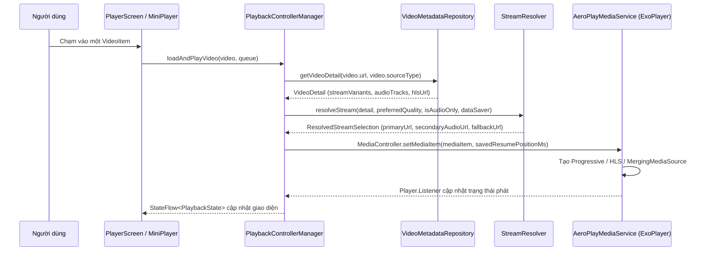

# ARCHITECTURE – Kiến Trúc Hệ Thống AeroPlay

Tài liệu này mô tả chi tiết kiến trúc phần mềm, luồng dữ liệu, luồng phát đa phương tiện, xử lý phát nền, Picture-in-Picture và cơ chế cách ly nguồn trích xuất trong **AeroPlay**.

---

## 1. Tổng Quan Kiến Trúc (MVVM + Clean Repository + StateFlow)

Hệ thống được phân tách thành các lớp độc lập để **giao diện (Compose UI)** và **Media Engine (Media3)** không bao giờ phụ thuộc trực tiếp vào bất kỳ nguồn nội dung cụ thể nào:

### Cấu trúc Package
- `com.aeroplay.app.core.common`: Các tiện ích định dạng thời lượng, lượt xem (`FormatUtils`).
- `com.aeroplay.app.core.model`: Toàn bộ các domain model chuẩn (`VideoItem`, `VideoDetail`, `ChannelItem`, `PlaylistItem`, `StreamVariant`, `AudioTrack`, `SubtitleTrack`, `PlaybackQueue`, `PlaybackState`, `PlaybackPosition`, `SourceError`).
- `com.aeroplay.app.core.database`: `AeroPlayDatabase`, `AeroPlayDao`, các Entity cho lịch sử xem, yêu thích, playlist, vị trí phát và lịch sử tìm kiếm.
- `com.aeroplay.app.core.network`: `NewPipeOkHttpDownloader`, `NetworkConnectivityObserver`, `NetworkModule`.
- `com.aeroplay.app.core.designsystem`: Hệ màu 2026 Obsidian/Coral/Violet (`Theme.kt`), `FloatingNavigationBar`, `VideoFeedCard`, `SkeletonVideoCard`, `ErrorStateCard`.
- `com.aeroplay.app.data.source`: `DemoLocalMediaSource` và `ExperimentalExtractorSource`.
- `com.aeroplay.app.data.repository`: các repository cốt lõi cùng các lớp triển khai Hilt Singleton; `PersonalizedRecommendations` tạo feed, `MusicRecommendations` nhận diện ca khúc/xếp hạng nhạc và `RemotePlaylistRepository` mở playlist nguồn.
- `com.aeroplay.app.playback.service`: `AeroPlayMediaService` (`MediaSessionService`).
- `com.aeroplay.app.playback.controller`: `PlaybackControllerManager`.
- `com.aeroplay.app.playback.pip`: `PipController`.
- `com.aeroplay.app.feature.*`: `home`, `search`, `player`, `library`, `settings`.

---

## 2. Luồng Dữ Liệu (Data Flow)

1. **Quan sát cấu hình thời gian thực:** `SettingsRepository` đọc từ Jetpack DataStore và phát `Flow<AppSettings>`. Khi người dùng đổi nguồn dữ liệu (`DEMO_LOCAL` hoặc `EXPERIMENTAL_EXTRACTOR`) hoặc đổi chế độ giao diện (`DARK`, `LIGHT`, `SYSTEM`), các ViewModel tự động nhận sự kiện qua `StateFlow` và làm mới dữ liệu.
2. **Tìm kiếm có Debounce và Hủy Request:**
   - Trong `SearchViewModel`, luồng nhập từ khóa được áp dụng `.debounce(400L).distinctUntilChanged().collectLatest { ... }`.
   - Khi người dùng gõ từ khóa mới hoặc rời màn hình, `collectLatest` / `activeSearchJob?.cancel()` sẽ hủy coroutine cũ. Nhờ `runInterruptible(Dispatchers.IO)` trong `ExperimentalExtractorSource`, luồng mạng `OkHttp` đang chạy bị ngắt ngay lập tức.
3. **Đề xuất nhạc và playlist:** `MusicSuggestionRepository` xếp video liên quan theo phong cách, giảm video cùng ca khúc và cùng kênh, rồi tìm một truy vấn nhạc có giới hạn khi cần thêm ứng viên. `PlaybackQueue.radioMode` đánh dấu phiên nghe để danh sách trên player, nút Next và tự phát dùng chung một thứ tự. `RemotePlaylistRepository` đọc các trang đầu playlist nguồn để phát theo thứ tự; phần còn lại được báo là chưa tải.
4. **Lưu trữ thư viện cá nhân:**
   - Mọi thao tác thêm yêu thích, tạo/đổi tên/xóa playlist, lưu lịch sử xem và tiến trình phát (`PlaybackPosition`) đều ghi xuống `AeroPlayDatabase` (Room) và cập nhật giao diện phản ứng (reactive) qua `Flow`.

---

## 3. Luồng Phát Media & Chọn Luồng (Playback & Stream Resolution Flow)

### Xử lý ghép luồng & Fallback an toàn
- Nếu người dùng chọn luồng **Progressive** (ví dụ `360p` hoặc `720p` có sẵn cả hình và tiếng): `AeroPlayMediaService` phát trực tiếp qua `DefaultMediaSourceFactory`.
- Nếu người dùng chọn luồng **Video-Only** độ phân giải cao (ví dụ `1080p` adaptive): `StreamResolver` ghép cặp với luồng `AudioTrack` tốt nhất và gửi `EXTRA_SECONDARY_AUDIO_URL` qua `MediaMetadata.extras`. `AeroPlayMediaService` tự động tạo `MergingMediaSource(videoSource, audioSource)`.
- **Cơ chế chống crash khi ghép luồng lỗi:** Nếu `MergingMediaSource` gặp lỗi giải mã hoặc mạng (`onPlayerError`), `PlaybackControllerManager` tự động chuyển sang `fallbackProgressiveUrl` tại đúng mili-giây đang xem (`currentPositionMs`) thay vì làm ứng dụng dừng đột ngột.
- **Chế độ Chỉ Âm Thanh (Audio-Only):** Khi bật chế độ chỉ nghe âm thanh, `StreamResolver` chọn trực tiếp URL của `AudioTrack` (`audio/mp4` hoặc `audio/webm`), giúp tiết kiệm băng thông di động thực sự.

---

## 4. Phát Âm Thanh Nền (Background Playback Flow)

1. `AeroPlayMediaService` kế thừa `androidx.media3.session.MediaSessionService` và được khai báo trong `AndroidManifest.xml` với `android:foregroundServiceType="mediaPlayback"`.
2. `ExoPlayer` được khởi tạo với `AudioAttributes` (`USAGE_MEDIA`, `AUDIO_CONTENT_TYPE_MOVIE`) cùng `handleAudioFocus = true` và `setHandleAudioBecomingNoisy(true)`:
   - Tự động giảm âm lượng hoặc tạm dừng khi có cuộc gọi đến / ứng dụng khác chiếm Audio Focus.
   - Tự động tạm dừng khi rút tai nghe dây hoặc ngắt tai nghe Bluetooth (có thể bật/tắt trong Cài đặt).
3. `DefaultMediaNotificationProvider` tự động hiển thị Media Notification trên thanh thông báo và màn hình khóa với đầy đủ ảnh bìa, tiêu đề, tên kênh và các nút `Play/Pause`, `Previous`, `Next`, `Seek`.
4. Khi ứng dụng bị đóng khỏi danh sách đa nhiệm (`onTaskRemoved`) mà không đang phát nhạc nền, service tự gọi `stopSelf()` và giải phóng `ExoPlayer` + `MediaSession` trong `onDestroy()` để tránh rò rỉ bộ nhớ (memory leak).

---

## 5. Luồng Cửa Sổ Nổi Picture-in-Picture (PiP Flow)

1. `MainActivity` khai báo `android:supportsPictureInPicture="true"` và `android:configChanges="screenSize|smallestScreenSize|screenLayout|orientation|keyboardHidden"`.
2. `PipController` xây dựng `PictureInPictureParams` với tỷ lệ khung hình hợp lệ (giữ trong ngưỡng chuẩn Android `0.42f..2.38f`) và gắn `RemoteAction` cho nút Play/Pause thông qua `BroadcastReceiver`.
3. Trên **Android 12+ (API 31+)**: `setAutoEnterEnabled(true)` được cập nhật động mỗi khi video đang phát. Trên **Android 8–11 (API 26–30)**: `onUserLeaveHint()` tự động kích hoạt `enterPictureInPictureMode()` khi người dùng rời ứng dụng lúc đang xem video.
4. Khi `onPictureInPictureModeChanged(true)` được gọi, `FullPlayerOverlay` tự động ẩn toàn bộ thanh điều hướng, tiêu đề, mô tả và các nút phụ, chỉ giữ lại khung hình `PlayerView` lấp đầy cửa sổ PiP.

---

## 6. Tích Hợp NewPipe Extractor (`ExperimentalExtractorSource`)

- Được đóng gói hoàn toàn trong `com.aeroplay.app.data.source.ExperimentalExtractorSource`.
- Sử dụng `NewPipeOkHttpDownloader` kết nối qua `OkHttpClient` với `User-Agent` tiêu chuẩn, **tuyệt đối không lưu trữ hay gửi cookie đăng nhập, token hoặc mật khẩu người dùng**.
- Mọi ngoại lệ từ `NewPipeExtractor` (`AgeRestrictedContentException`, `GeographicRestrictionException`, `PrivateContentException`, `PaidContentException`, `ReCaptchaException`, `ParsingException`) đều được ánh xạ minh bạch sang `SourceError` để thông báo trung thực cho người dùng.
